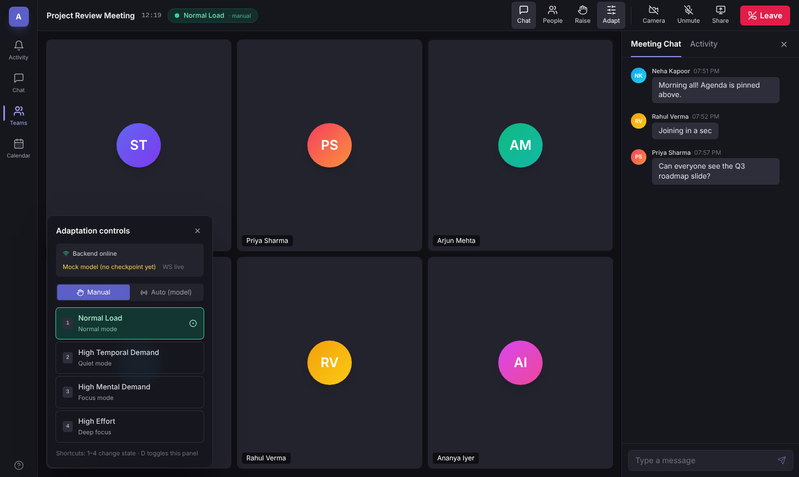
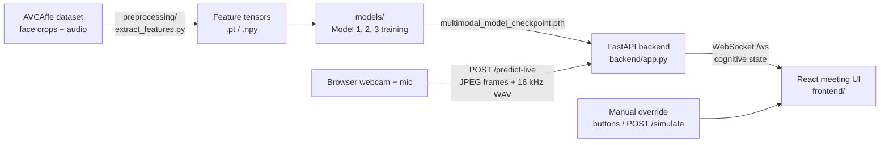

# Affect-Aware Dynamic UI

**Real-time cognitive-load detection from audio-visual cues, used to adapt a video-meeting interface.**

Remote workers spend hours in meeting apps that keep pushing chat messages, badges and notifications at them, even when they are under heavy cognitive load. This project trains a multimodal (video + audio) model on the **AVCAffe** dataset to predict cognitive-load dimensions (Mental Demand, Temporal Demand, Effort), then uses those predictions to adapt a Microsoft Teams-style meeting interface in real time: collapsing the chat, holding notifications, and spotlighting the active speaker when load is high.

| Normal mode | Focus mode (High Mental Demand) |
|---|---|
|  |  |

---

## System architecture



1. **Data** (Member 1): AVCAffe face crops and audio are turned into video and log-mel audio feature tensors, with participant-disjoint train/val splits.
2. **Models** (Members 2 and 3): Model 1 (unimodal baseline), Model 2 (Random Forest on extracted features) and **Model 3 (multimodal late fusion)**, the core contribution.
3. **Backend** (Member 4): FastAPI loads the Model 3 checkpoint, preprocesses live webcam and mic windows, predicts P(High) per dimension, smooths the predictions, and pushes the resulting state over a WebSocket.
4. **Frontend** (Member 4): a React + Tailwind meeting UI that applies an adaptation policy for each state.

### Adaptation policy

| Predicted state | UI mode | Chat panel | Notifications and badges | Video layout |
|---|---|---|---|---|
| Normal Load | Normal | Open | Shown | Gallery |
| High Temporal Demand | Quiet mode | Collapsed | Held | Gallery |
| High Mental Demand | Focus mode | Collapsed | Held | Speaker spotlight + filmstrip |
| High Effort | Deep focus | Collapsed | Held | Active speaker only |

Notifications that arrive during a high-load state are **held rather than lost**. When the user returns to Normal Load, a single "While you were focused" summary appears. The user can always reopen the chat manually, and that choice is respected until the state changes. The policy lives in one table, `frontend/src/config.js`.

To avoid the UI flickering on noisy predictions, the backend smooths each dimension with an exponential moving average plus hysteresis: P(High) must rise above **0.60** to enter a high state and fall below **0.40** to leave it (`StateSmoother` in `backend/inference.py`).

---

## Setup and running

**Requirements:** Python 3.10+, Node.js 18+.

```bash
git clone https://github.com/Rhy404/Affect-Aware-Dynamic-UI.git
cd Affect-Aware-Dynamic-UI

# 1. Python dependencies (everyone)
python -m venv venv
source venv/bin/activate          # Windows: venv\Scripts\activate
pip install -r requirements.txt

# 2. Start the backend (from the repo root)
uvicorn backend.app:app --reload --port 8000
#    -> http://127.0.0.1:8000/docs  (interactive API docs)

# 3. Start the frontend (in a second terminal)
cd frontend
npm install
npm run dev
#    -> http://localhost:3000
```

With no checkpoint present, the backend runs in **mock mode**, so the UI works end to end before training is done. To point the frontend at a different backend URL, create `frontend/.env.local` containing `VITE_API_URL=http://<host>:8000`.

**Run the backend tests:** `python -m pytest backend/tests -q`

---

## Demo guide (for the presentation)

Click **Adapt** in the top bar (or press **D**) to open the control panel.

- **Manual mode (Option B, the reliable backup):** click a state or press **1–4**. The UI adapts instantly, with no camera, model or network involved.
- **Auto mode (Option A, live inference):** click *Start live sensing*. Every 2.5 s the browser sends a 2-second window of webcam frames and microphone audio to `/predict-live`. The panel shows the smoothed P(High) for each dimension against the 60% threshold.
- **Remote control:** in Auto mode the UI also follows states pushed from anywhere, e.g. a teammate's laptop:
  ```bash
  curl -X POST http://127.0.0.1:8000/simulate -H "Content-Type: application/json" -d '{"state": "High Effort"}'
  ```

---

## Backend API

| Method | Path | Purpose |
|---|---|---|
| GET | `/health` | Status, `model` vs `mock` mode, loaded checkpoints and their input sizes |
| GET | `/state` | Current cognitive state |
| POST | `/predict-load` | Predict from precomputed features: `{"video_features": [...256], "audio_features": [...128]}`. With no body it returns a mock prediction, as in the plan |
| POST | `/predict-live` | Multipart upload: `frames` (JPEG images) + `audio` (16-bit PCM WAV) |
| POST | `/simulate` | Force a state: `{"state": "High Mental Demand"}` |
| POST | `/reset` | Clear smoothing and return to Normal Load |
| WS | `/ws` | Pushes every state change |

Every prediction returns:

```json
{
  "cognitive_state": "High Mental Demand",
  "trigger_focus_mode": true,
  "source": "model",
  "probabilities": {"mental_demand": 0.81},
  "smoothed": {"mental_demand": 0.74},
  "timestamp": 1731070000.0,
  "face_detected": true
}
```

---

## Integration contracts (hand-offs between members)

### Member 2 → backend: the trained checkpoint
Save the weights with `torch.save(model.state_dict(), "multimodal_model_checkpoint.pth")` and place the file in `backend/`. The backend reads the input sizes and number of classes **from the checkpoint itself**, so changing the 256/128 feature sizes needs no backend edits. It assumes:
- class **1 = High** load (score > 10) and class 0 = Low;
- layer names match `backend/fusion_model.py` (`video_branch`, `audio_branch`, `fusion_mlp`). If you change the architecture, update that file to match.

Optional extra binary models, one per dimension, are picked up automatically: `temporal_demand_checkpoint.pth` and `effort_checkpoint.pth`. `/health` reports any checkpoint that fails to load, along with the reason.

> `.pth` files are git-ignored. Share them through Google Drive.

### Member 1 → backend: live preprocessing
For live predictions to mean anything, webcam and mic data must be preprocessed **exactly** like the training data. If `preprocessing/extract_features.py` defines these two functions, the backend uses them automatically:

```python
def video_features_from_frames(frames: list[np.ndarray]) -> np.ndarray: ...
    # ~2 s of BGR uint8 webcam frames -> 1-D feature vector (same as training)

def audio_features_from_waveform(waveform: np.ndarray, sample_rate: int) -> np.ndarray: ...
    # ~2 s of mono float32 audio in [-1, 1] -> 1-D feature vector (same as training)
```

Until then, placeholder features of the right size are used (face crop → 16×16 → 256-d; 128-bin log-mel mean → 128-d), and `/health` reports `"placeholder_features": true`.

---

## Model comparison (filled in by Member 3)

| Model | Modality | F1-score | Precision | Recall |
|---|---|---|---|---|
| Model 1: Unimodal baseline | Video only | – | – | – |
| Model 2: Random Forest | Extracted features | – | – | – |
| **Model 3: Multimodal late fusion** | Video + audio | – | – | – |

*Evaluated on the participant-disjoint AVCAffe validation split. See `models/evaluate.py`.*

---

## Repository structure

```
Affect-Aware-Dynamic-UI/
├── requirements.txt            # shared Python dependencies
├── preprocessing/              # Member 1: AVCAffe feature extraction + split checks
├── models/                     # Members 2 & 3: dataset, Model 3, baselines, evaluation
├── backend/                    # Member 4: FastAPI inference server
│   ├── app.py                  #   routes + WebSocket
│   ├── inference.py            #   checkpoint loading, mock mode, smoothing
│   ├── features.py             #   live webcam/mic -> features (Member 1 contract)
│   ├── fusion_model.py         #   Model 3 architecture used to load the checkpoint
│   └── tests/
├── frontend/                   # Member 4: React + Tailwind meeting UI
│   ├── src/App.js              #   state logic + adaptation
│   ├── src/config.js           #   adaptation policy table
│   ├── src/components/         #   LeftRail, TopBar, VideoGrid, SidePanel, Toasts, DemoPanel
│   └── src/hooks/              #   backend WebSocket, live sensing, simulated meeting
└── docs/                       # screenshots
```

## Git workflow

`main` (final, protected) ← `dev` (integration) ← feature branches: `feature/data-preprocessing` (Member 1), `feature/multimodal-fusion-model` (Member 2), `feature/baseline-models` (Member 3), `feature/ui-dashboard` (Member 4). Push to your feature branch, open a PR into `dev`, get one teammate's review, then merge.

## Team

| Member | Role |
|---|---|
| Siddharth | Data custodian and preprocessing lead |
| Rhythima | Core ML architect (multimodal model) |
| Bharat | Baseline and comparative ML engineer |
| Sanya | Systems, UI and integration lead |

## References

Sarkar, P., Posen, A., & Etemad, A. (2022). *AVCAffe: A Large Scale Audio-Visual Dataset of Cognitive Load and Affect for Remote Work.* AAAI 2023. https://github.com/pritamqu/AVCAffe
