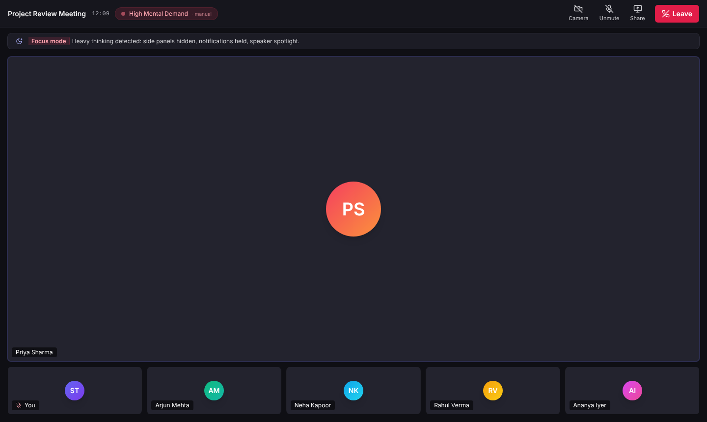
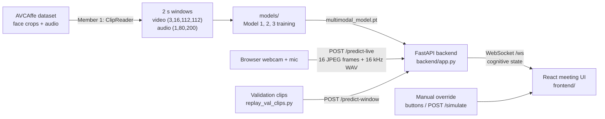

# Affect-Aware Dynamic UI

**Real-time cognitive-load detection from audio-visual cues, used to adapt a video-meeting interface.**

Remote workers spend hours in meeting apps that keep pushing chat messages, badges and notifications at them, even when they are under heavy cognitive load. This project trains a multimodal (video + audio) model on the **AVCAffe** dataset to predict cognitive-load dimensions (Mental Demand, Temporal Demand, Effort), then uses those predictions to adapt a Microsoft Teams-style meeting interface in real time: collapsing the chat, holding notifications, and spotlighting the active speaker when load is high.

| Normal mode | Focus mode (High Mental Demand) |
|---|---|
|  |  |

---

## System architecture



1. **Data** (Member 1): AVCAffe clips are cut into aligned 2-second windows: 16 RGB face-crop frames at 8 fps (112×112) and an 80-bin log-mel spectrogram (16 kHz, 10 ms hop), normalised with train-set statistics, using the official participant-disjoint train/val split. Each window has three binary labels (score > 10 = High) in the order Mental Demand, Effort, Temporal Demand.
2. **Models** (Members 2 and 3): Model 1 (unimodal baseline), Model 2 (Random Forest on extracted features) and **Model 3 (multimodal late fusion)**, the core contribution.
3. **Backend** (Member 4): FastAPI loads the trained model, turns live webcam and mic windows into the **same** tensors as Member 1's pipeline (reusing his `log_mel` and normalisation stats), predicts P(High) per dimension, smooths the predictions, and pushes the resulting state over a WebSocket.
4. **Frontend** (Member 4): a React + Tailwind meeting UI that applies an adaptation policy for each state.

### Adaptation policy

| Predicted state | UI mode | Chat panel | Notifications and badges | Video layout |
|---|---|---|---|---|
| Normal Load | Normal | Open | Shown | Gallery |
| High Temporal Demand | Quiet mode | Collapsed | Held | Gallery |
| High Mental Demand | Focus mode | Collapsed | Held | Speaker spotlight + filmstrip |
| High Effort | Deep focus | Collapsed | Held | Active speaker only |

Notifications that arrive during a high-load state are **held rather than lost**. When the user returns to Normal Load, a single "While you were focused" summary appears. The user can always reopen the chat manually, and that choice is respected until the state changes. The policy lives in one table, `frontend/src/config.js`.

To avoid the UI flickering on noisy predictions, the backend smooths each dimension with an exponential moving average plus hysteresis: P(High) must rise above **0.60** to enter a high state and fall below **0.40** to leave it (`StateSmoother` in `backend/inference.py`).

---

## Setup and running

**Requirements:** Python 3.10+, Node.js 18+.

```bash
git clone https://github.com/Rhy404/Affect-Aware-Dynamic-UI.git
cd Affect-Aware-Dynamic-UI

# 1. Python dependencies (everyone)
python -m venv venv
source venv/bin/activate          # Windows: venv\Scripts\activate
pip install -r requirements.txt

# 2. Start the backend (from the repo root)
uvicorn backend.app:app --reload --port 8000
#    -> http://127.0.0.1:8000/docs  (interactive API docs)

# 3. Start the frontend (in a second terminal)
cd frontend
npm install
npm run dev
#    -> http://localhost:3000
```

With no model file present, the backend runs in **mock mode**, so the UI works end to end before training is done. To point the frontend at a different backend URL, create `frontend/.env.local` containing `VITE_API_URL=http://<host>:8000`.

**Using a trained model with live sensing.** The backend reuses Member 1's preprocessing code (`preprocessing/audio_features.py`, `preprocessing/video_features.py`) and `configs/norm_stats.json`, read-only, to build live tensors. Both are found automatically inside this repo, and `GET /health` → `"preprocessing"` shows what was found. To use a copy somewhere else, set `AFFECT_PREPROCESSING_DIR` and `AFFECT_NORM_STATS`.

**Run the backend tests:** `python -m pytest backend/tests -q` (19 tests, including 3 that check the live tensors are identical to Member 1's `ClipReader` output).

---

## Demo guide (for the presentation)

Click **Adapt** in the top bar (or press **D**) to open the control panel.

- **Manual mode (Option B, the reliable backup):** click a state or press **1–4**. The UI adapts instantly, with no camera, model or network involved.
- **Auto mode (Option A, live inference):** click *Start live sensing*. Every 2.5 s the browser sends a 2-second window (16 webcam frames + microphone audio) to `/predict-live`. The panel shows the smoothed P(High) for each dimension against the 60% threshold. Windows where a face is visible in fewer than 75% of frames are skipped, as in training.
- **Replay validation clips (Option C, the honest model demo):** live webcam face crops never look exactly like AVCAffe's, so the clearest proof that the *trained* model drives the UI is to replay held-out validation windows. With the UI in Auto mode, run:
  ```bash
  python -m backend.replay_val_clips --data C:\dev\data\avcaffe --n 30
  ```
  It plays alternating blocks of Low and High Mental Demand clips and prints the true labels next to the predictions, while the UI switches modes.
- **Remote control:** in Auto mode the UI also follows states pushed from anywhere, e.g. a teammate's laptop:
  ```bash
  curl -X POST http://127.0.0.1:8000/simulate -H "Content-Type: application/json" -d '{"state": "High Effort"}'
  ```

---

## Backend API

| Method | Path | Purpose |
|---|---|---|
| GET | `/health` | Status, `model` vs `mock` mode, model load errors, whether Member 1's preprocessing was found, expected tensor shapes |
| GET | `/state` | Current cognitive state |
| POST | `/predict-load` | The plan's original endpoint (no body): a mock prediction. With a real model, use the two below |
| POST | `/predict-live` | Multipart upload: `frames` (~16 JPEG images over 2 s) + `audio` (16-bit PCM WAV) |
| POST | `/predict-window` | Multipart upload: `window`, an `.npz` with `video` (3,16,112,112) and `audio` (1,80,200) exactly as `ClipReader` returns them, plus optional `labels` |
| POST | `/simulate` | Force a state: `{"state": "High Mental Demand"}` |
| POST | `/reset` | Clear smoothing and return to Normal Load |
| WS | `/ws` | Pushes every state change |

Every prediction returns:

```json
{
  "cognitive_state": "High Mental Demand",
  "trigger_focus_mode": true,
  "source": "model",
  "probabilities": {"mental_demand": 0.81, "effort": 0.35, "temporal_demand": 0.22},
  "smoothed": {"mental_demand": 0.74, "effort": 0.31, "temporal_demand": 0.25},
  "timestamp": 1731070000.0,
  "face_fraction": 1.0,
  "skipped": false
}
```

---

## Integration contracts (hand-offs between members)

### Member 1 → backend: data format (done)
Member 1's pipeline (`preprocessing/`, `ClipReader` in `dataset.py`; documented in [preprocessing/README.md](preprocessing/README.md)) produces, per 2-second window:

| Tensor | Shape | Contents |
|---|---|---|
| `video` | (3, 16, 112, 112) | RGB face crops, 16 frames at 8 fps, `x/255` then per-channel `(x − mean) / std` |
| `audio` | (1, 80, 200) | 80-bin log-mel, 16 kHz, 10 ms hop, `(x − mean) / std` |
| `labels` | (3,) | `mental_demand_bin`, `effort_bin`, `temporal_demand_bin` (1 = High, score > 10; −1 = missing) |

The backend builds the same tensors from live webcam and mic data (`backend/features.py`). It loads his `audio_features.py`, `video_features.py` and `configs/norm_stats.json` read-only, and does not copy or modify them. A test checks that the live tensors equal `ClipReader`'s output. The one step that cannot be identical is the face crop: AVCAffe ships its own crops, while live frames are cropped with OpenCV's face detector (largest face, 20% margin).

> Note for the team: the plan's original Model 3 took 256-d video and 128-d audio **vectors**. Member 1's data is raw **tensors**, so Model 3 needs encoders (e.g. a 3D CNN for video and a 2D CNN for the spectrogram) before fusion, and the Random Forest baseline needs a feature-extraction step to flatten or pool the windows.

### Member 2 → backend: the trained model
The backend calls `model(video, audio)` with `video` (B,3,16,112,112) and `audio` (B,1,80,200). The easiest hand-off needs no copy of the model class. Export it once after training and put the file in `backend/`:

```python
model.eval()
example = (torch.zeros(1, 3, 16, 112, 112), torch.zeros(1, 1, 80, 200))
torch.jit.trace(model, example).save("backend/multimodal_model.pt")        # TorchScript
# or, on newer PyTorch:
torch.export.save(torch.export.export(model, example), "backend/multimodal_model.pt2")
```

Accepted outputs, in Member 1's label order (Mental Demand, Effort, Temporal Demand):
- `(B, 3)` one logit per target (multi-label, sigmoid);
- `(B, 3, 2)` two-class logits per target (class 1 = High);
- a tuple of 3 heads, each `(B, 2)` or `(B, 1)`;
- `(B, 2)` or `(B, 1)` if only Mental Demand is trained.

A plain `state_dict` (`backend/multimodal_model_checkpoint.pth`) also works, if `AFFECT_MODEL_CLASS=package.module:ClassName` points to a class that can be built with no arguments. `/health` shows any load error.

> Model files (`.pt`, `.pt2`, `.pth`) are git-ignored. Share them through Google Drive.

---

## Model comparison (filled in by Member 3)

| Model | Modality | F1-score | Precision | Recall |
|---|---|---|---|---|
| Model 1: Unimodal baseline | Video only | – | – | – |
| Model 2: Random Forest | Extracted features | – | – | – |
| **Model 3: Multimodal late fusion** | Video + audio | – | – | – |

*Evaluated on the participant-disjoint AVCAffe validation split. See `models/evaluate.py`.*

---

## Repository structure

```
Affect-Aware-Dynamic-UI/
├── requirements.txt            # shared Python dependencies
├── configs/norm_stats.json     # Member 1: train-set normalisation statistics
├── preprocessing/              # Member 1: AVCAffe preprocessing pipeline (see preprocessing/README.md)
├── notebooks/                  # Member 2: training notebooks
├── models/                     # Members 2 & 3: dataset, Model 3, baselines, evaluation
├── backend/                    # Member 4: FastAPI inference server
│   ├── app.py                  #   routes + WebSocket
│   ├── inference.py            #   model loading (TorchScript / torch.export), mock mode, smoothing
│   ├── features.py             #   live webcam/mic -> Member 1's tensors (reuses his code read-only)
│   ├── replay_val_clips.py     #   demo: stream validation windows through the model and UI
│   └── tests/
├── frontend/                   # Member 4: React + Tailwind meeting UI
│   ├── src/App.js              #   state logic + adaptation
│   ├── src/config.js           #   adaptation policy table
│   ├── src/components/         #   LeftRail, TopBar, VideoGrid, SidePanel, Toasts, DemoPanel
│   └── src/hooks/              #   backend WebSocket, live sensing, simulated meeting
└── docs/                       # screenshots
```

## Git workflow

`main` (final, protected) ← `dev` (integration) ← feature branches: `feature/data-preprocessing` (Member 1), `feature/multimodal-fusion-model` (Member 2), `feature/baseline-models` (Member 3), `feature/ui-dashboard` (Member 4). Push to your feature branch, open a PR into `dev`, get one teammate's review, then merge.

## Team

| Member | Role |
|---|---|
| Siddharth | Data custodian and preprocessing lead |
| Rhythima | Core ML architect (multimodal model) |
| Bharat | Baseline and comparative ML engineer |
| Sanya | Systems, UI and integration lead |

## References

Sarkar, P., Posen, A., & Etemad, A. (2022). *AVCAffe: A Large Scale Audio-Visual Dataset of Cognitive Load and Affect for Remote Work.* AAAI 2023. https://github.com/pritamqu/AVCAffe
